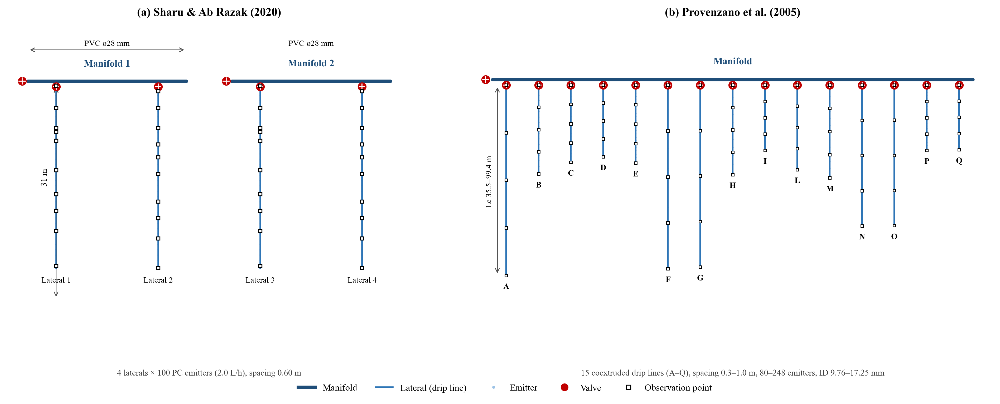

# wdrip 验证：对照两篇滴灌毛管水力文献

用 aQuaDrip 的核心库 wdrip（`wdrip-core`）复现两篇滴灌毛管水力实验文献的结果，
作为其水力计算能力的**外部文献验证**。

| case | 文献 | 复现侧重 | 脚本 |
|---|---|---|---|
| case1 | Sharu & Ab Razak (2020), *Water* 12(8):2295 | **压力补偿滴头**、31 m 毛管、沿程压力剖面 | `case1/reproduce_sharu2020.py` |
| case2 | Provenzano, Pumo & Di Dio (2005), *J. Irrig. Drain. Eng.* 131(6):525–532 | **非 PC 共挤滴头**、15 型毛管（0.3–1.0 m 间距）总水头损失 | `case2/reproduce_provenzano2005.py` |

> **论文正文草稿**：可直接用于论文的验证小节见
> [`validation_section_zh.md`](validation_section_zh.md)（正文叙述 + 表 1–5 + 参考文献）。

## 结果总览

**系统布置图**（全英文，SCI 排版，300 dpi；a=案例一，b=案例二）



> 仅标示四类要素：manifold、滴灌带（lateral）、阀门、观测点（滴头以细点示意）。
> 由 `make_layout_figures.py` 生成，同时输出矢量 PDF。

## case1 结果（Sharu & Ab Razak 2020）

PC 滴头（恒流 2 L/h）、LDPE 内径 17.5 mm × 31 m、100 个滴头、manifold 压力 26.03 m。

| 位置 | wdrip (m) | 论文 EPANET (m) | 实测 (m) | 与 EPANET 差 |
|---|---|---|---|---|
| 首段 | 25.89 | — | — | — |
| 滴头 #4 | 25.48 | 25.54 | 24.46 | 0.06 m |
| 末端 #100 | 21.26 | 21.40 | 21.77 | 0.14 m |
| 累计水头损失 | 4.63 | 4.63 | 4.26 | 0.00 m |

结论：累计损失与论文 EPANET **完全一致**，锚点压力偏差 ≤0.14 m（≤0.6% 进口水头），
小于论文自身实测-模拟差（RMSE 0.61 m）。PC 滴头流量全程恒为 2.000 L/h。

## case2 结果（Provenzano et al. 2005）

15 种商用共挤滴灌带（A–Q），间距 0.3–1.0 m、管径 9.76–17.25 mm、
滴头数 80–248。论文表 4 给出实测总水头损失 $h_{T,m}$ 与估算值 $h_{T,e}$。

| 型号 | S (m) | N | $h_{T,m}$ | $h_{T,e}$ | wdrip | vs 实测 | vs 估算 |
|---|---|---|---|---|---|---|---|
| A | 1.0 | 100 | 4.08 | 4.04 | 3.94 | −3.50% | −2.55% |
| B | 0.4 | 120 | 1.40 | 1.41 | 1.39 | −0.56% | −1.26% |
| C | 0.3 | 140 | 1.98 | 1.54 | 1.55 | −21.48% | +0.96% |
| D | 0.3 | 130 | 1.21 | 1.11 | 1.10 | −9.39% | −1.22% |
| E | 0.3 | 140 | 4.04 | 4.19 | 4.18 | +3.42% | −0.29% |
| F | 1.0 | 96 | 0.75 | 0.71 | 0.70 | −7.22% | −1.99% |
| G | 1.0 | 95 | 1.13 | 0.88 | 0.87 | −23.05% | −1.18% |
| H | 0.6 | 80 | 0.50 | 0.41 | 0.40 | −19.20% | −1.46% |
| I | 0.3 | 120 | 0.89 | 0.90 | 0.90 | +1.55% | +0.42% |
| L | 0.3 | 152 | 0.48 | 0.46 | 0.46 | −3.75% | +0.43% |
| M | 0.5 | 100 | 0.52 | 0.51 | 0.51 | −2.77% | −0.86% |
| N | 0.3 | 248 | 1.16 | 1.03 | 1.03 | −11.03% | +0.20% |
| O | 0.6 | 124 | 0.47 | 0.39 | 0.39 | −17.30% | −0.34% |
| P | 0.3 | 120 | 2.33 | 2.59 | 2.58 | +10.82% | −0.31% |
| Q | 0.3 | 120 | 2.88 | 3.15 | 3.06 | +6.19% | −2.91% |

| 基准 | MAPE | MBE | RMSE | 最大误差 |
|---|---|---|---|---|
| 对照实测 $h_{T,m}$ | 9.41% | −6.48% | 11.90% | 23.05% |
| 对照估算 $h_{T,e}$ | **1.09%** | −0.82% | 1.36% | 2.91% |

**结论**：
- 与论文**计算值** MAPE 仅 **1.09%**，15 型中 14 型在 ±3% 以内；
- 与**实测值** MAPE 9.41%，偏差以负向为主，但文献自身模型同样偏低
  （表 4 报告 C、G 型的模型-实测偏差为 −22.2%、−22.1%，与 wdrip 的 −21.48%、
  −23.05% 几乎重合）——属实验数据与"恒定出流"假设的系统差异；
- 数据可靠性：表 4 在 15 型上均满足 $h_{T,m}=H_{in}-H_{fin}$、
  $h_{T,e}=h_f+h_L$，$Q_{in}/(N\bar q)$ 介于 0.89–1.07。

## 复现口径与差异说明

1. **求解引擎**：本机 EPANET 二进制库崩溃，wdrip 回退至迭代 WNTR 求解器（逐点施加
   $q=kP^x$）。精度档取 `high`。
2. **case1 局部损失**：论文未给出滴头插入件几何，其局部损失无法独立复原，故每段
   `minor_loss` 取等效值 $K=51.3$ 以对齐论文累计损失 4.63 m。属**等效参数**。
3. **两案例的摩阻口径**：文献分别用 Darcy–Weisbach（case1）与 Blasius（case2），
   wdrip 固定 Hazen–Williams。统一采用**等效糙率**（参考流量下令两者单长损失相等，
   反解 $C$），不针对实测值拟合。因流量指数不同（1.752 vs 1.75/1.852），
   分段积分留约 −1% 量级残差。
4. **管段长度（已修复）**：早期版本执行 `length = max(link.length, 1)`，会把
   <1 m 的管段放大（0.3 m 间距时水头损失约放大 3.3 倍）。**该限制已移除**，
   案例二 15 型全部按实际间距离散；回归测试见
   `wdrip-core/tests/test_simulation.py::TestShortSegmentLength`。

## 模拟精度与计算耗时

wdrip 内置三档精度（`fast` max_iter=5 / `standard` 8 / `high` 15）。预热后重复
3 次取最短耗时：

| 算例 | 精度档 | 运行时间 (s) | 相对耗时 | 流量相对误差 | 末端压力误差 (m) |
|---|---|---|---|---|---|
| case1 (N=100) | fast | 0.1556 | 0.72 | 0.000000% | 3.6e-15 |
| case1 (N=100) | standard | 0.1959 | 0.91 | 0.000000% | 3.6e-15 |
| case1 (N=100) | high | 0.2153 | 1.00 | 基准 | 0 |
| case2-A (N=100) | fast | 0.2353 | 0.71 | 0.386494% | 1.7e-01 |
| case2-A (N=100) | standard | 0.2845 | 0.86 | 0.102268% | 4.4e-02 |
| case2-A (N=100) | high | 0.3308 | 1.00 | 基准 | 0 |
| case2-F (N=96) | fast | 0.1357 | 0.48 | 0.040696% | 2.1e-02 |
| case2-F (N=96) | standard | 0.1869 | 0.66 | 0.001254% | 6.5e-04 |
| case2-F (N=96) | high | 0.2842 | 1.00 | 基准 | 0 |
| case2-G (N=95) | fast | 0.1905 | 0.78 | 0.002785% | 1.4e-03 |
| case2-G (N=95) | standard | 0.1871 | 0.77 | 0.002785% | 1.4e-03 |
| case2-G (N=95) | high | 0.2431 | 1.00 | 基准 | 0 |

**要点**：
1. **案例一对档位不敏感**——PC 滴头流量与压力解耦，三档结果一致（差异在舍入量级）；
2. **案例二敏感**——非 PC 滴头需迭代耦合。A 型（管径最小 12.98 mm、流量最大 4.7 L/h）
   在 `fast` 档偏差达 0.386%，`standard` 降至 0.102%；F、G 型 `fast` 已足够；
3. **耗时**——`high` 相对最低耗时档增加约 109%，绝对差在 0.1 s 量级。

**建议**：非 PC 滴头 + 细管径（<13 mm）或长毛管（>90 m）用 `standard`/`high`；
PC 滴头或短毛管可用 `fast`。

## 文件

```
examples/
├── validation_section_zh.md                  # 论文验证小节草稿（表 1–5）
├── README_validation.md                      # 本文件
├── make_layout_figures.py                    # 布置图（PNG + 矢量 PDF）
├── bench_precision.py                        # 精度/耗时基准
├── benchmarks/bench_precision.json           # 基准原始数据
├── figures/
│   └── fig_layout_case1_case2.{png,pdf}
├── case1/
│   ├── reproduce_sharu2020.py                # 复现脚本
│   ├── sharu2020_profile.json                # 压力/流量剖面 + 锚点
│   └── water-12-02295.pdf                    # 原文
└── case2/
    ├── reproduce_provenzano2005.py           # 复现脚本
    ├── provenzano2005_results.json           # 15 型结果 + 统计
    └── provenzano2005.pdf                    # 原文
```

## 运行

```bash
# 案例一（--sweep 可复现等效 K 的拟合过程）
MPLCONFIGDIR=/tmp/mplcfg .venv/bin/python examples/case1/reproduce_sharu2020.py

# 案例二
MPLCONFIGDIR=/tmp/mplcfg .venv/bin/python examples/case2/reproduce_provenzano2005.py

# 布置图 + 精度基准
MPLCONFIGDIR=/tmp/mplcfg .venv/bin/python examples/make_layout_figures.py
MPLCONFIGDIR=/tmp/mplcfg .venv/bin/python examples/bench_precision.py
```

## 参考文献

- Provenzano, G., Pumo, D., & Di Dio, P. (2005). Simplified procedure to evaluate head
  losses in drip irrigation laterals. *Journal of Irrigation and Drainage Engineering,
  131*(6), 525–532. https://doi.org/10.1061/(ASCE)0733-9437(2005)131:6(525)
- Sharu, E. H., & Ab Razak, M. S. (2020). Hydraulic performance and modelling of
  pressurized drip irrigation system. *Water, 12*(8), 2295.
  https://doi.org/10.3390/w12082295
